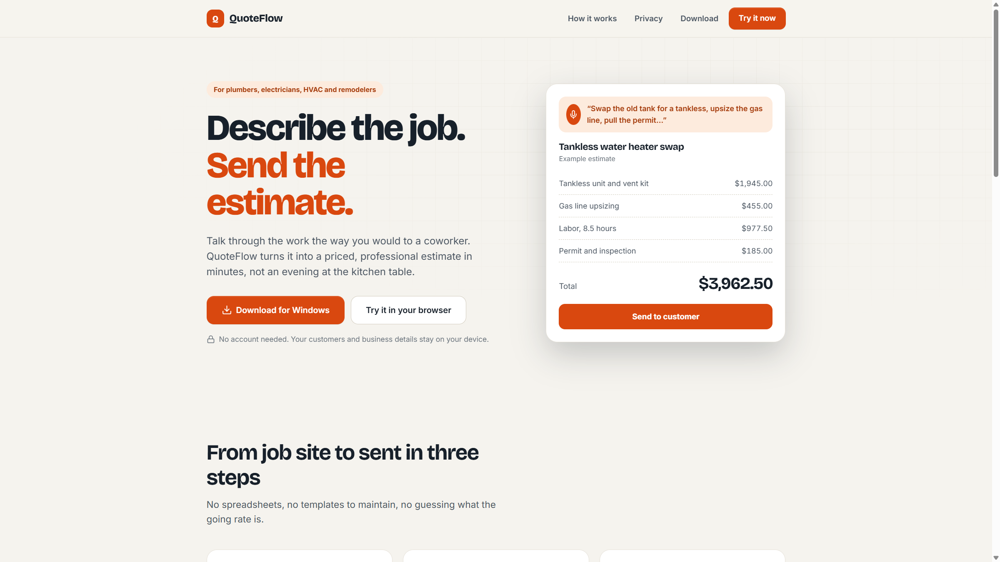
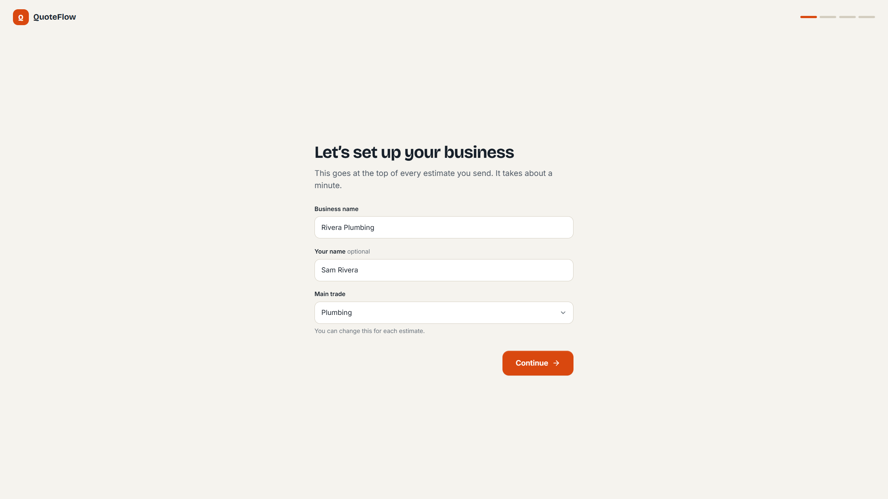
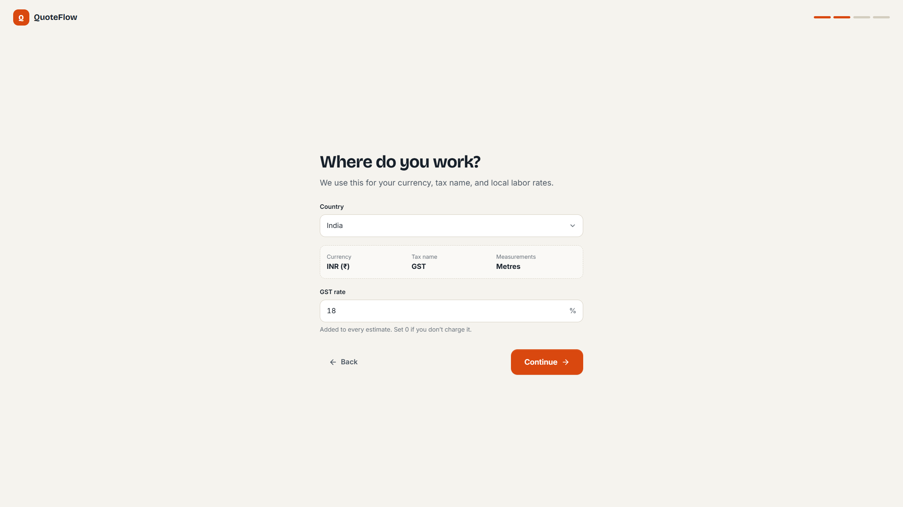
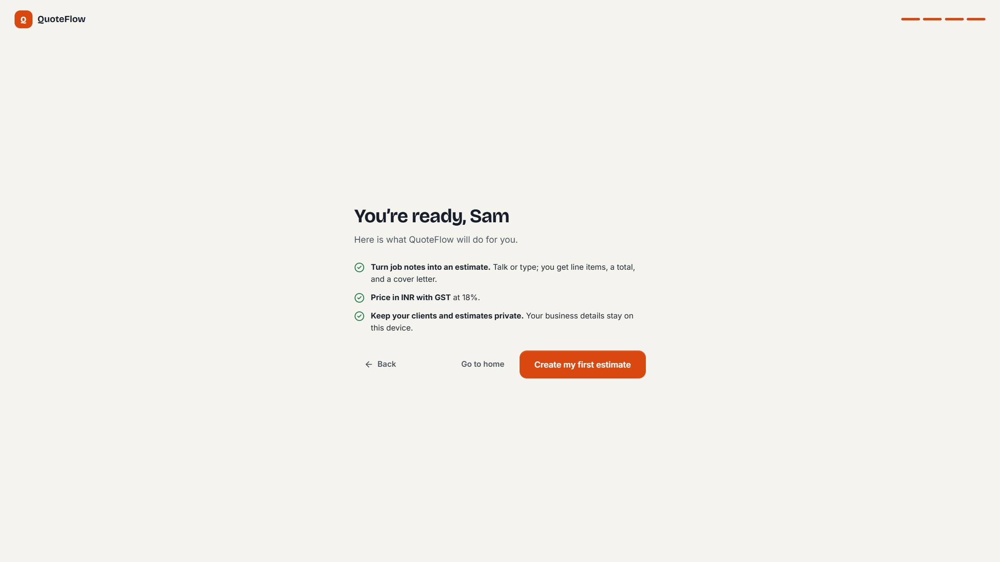
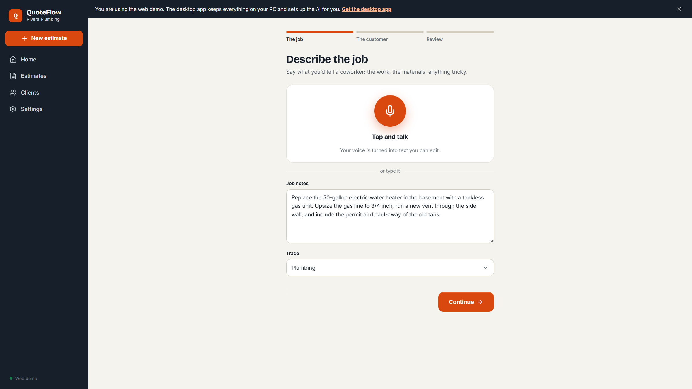
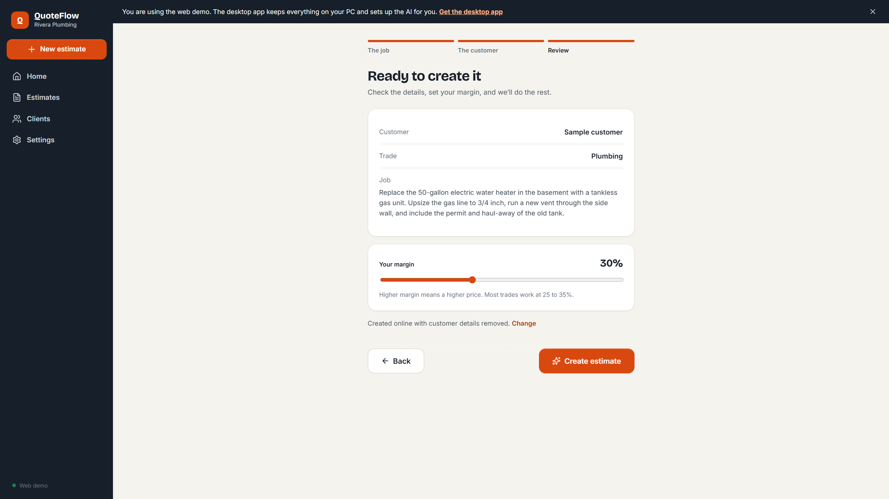
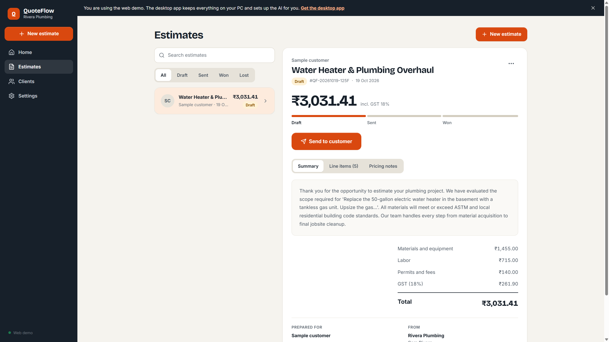
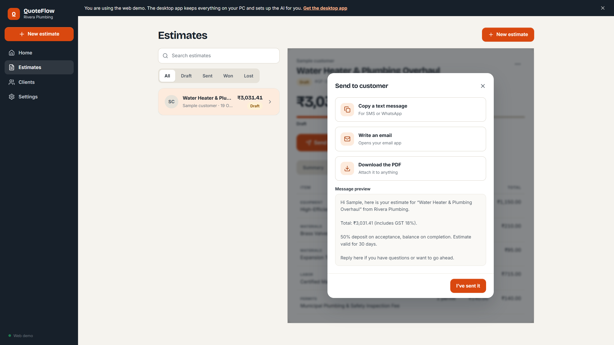

# QuoteFlow — Describe the job. Send the estimate.

> **Hacktoberfest 2026 · Open-Source AI Challenge · Week 2 — Side Hustle**  
> Contractor estimating: **3 hours → ~8 minutes**. Open-weight Gemma on the desktop; hosted demo on Render with Groq Gemma when the laptop can’t run a local model.

[](https://quoteflow-frontend-qlqc.onrender.com)
[](https://www.youtube.com/watch?v=QWjo5eLsmtM)
[](https://dev.to/challenges/hacktoberfest-week2-2026-10-12)
[](LICENSE)

| | |
|--|--|
| **Live demo** | [quoteflow-frontend-qlqc.onrender.com](https://quoteflow-frontend-qlqc.onrender.com) |
| **API** | [quoteflow-backend-q60x.onrender.com](https://quoteflow-backend-q60x.onrender.com/api/health) |
| **Demo video** | [YouTube walkthrough](https://www.youtube.com/watch?v=QWjo5eLsmtM) |
| **Repo** | [Mavros-Lykos/QuoteFlow](https://github.com/Mavros-Lykos/QuoteFlow) |

**Docs:** [PRODUCT](PRODUCT.md) · [DESIGN](DESIGN.md) · [PRODUCTION_READY](PRODUCTION_READY.md) · [SUBMISSION](SUBMISSION_REVIEW.md) · [PARTNER KEYS](PARTNER_KEYS_SETUP.md) · [DECISIONS](DECISION_REVIEW.md)

---

## Demo video

[](https://www.youtube.com/watch?v=QWjo5eLsmtM)

*Click the thumbnail → full walkthrough on YouTube.*

**Try it yourself (judges):** open the [live demo](https://quoteflow-frontend-qlqc.onrender.com) → **Try it in your browser** → complete Welcome → create a sample plumbing estimate → Send / PDF.

---

## Screenshots

### Landing



### First-run setup (region-aware — India / INR / GST)







### Voice-first new estimate





### Generated estimate + send





---

## Who pays for this?

Solo plumbers, electricians, HVAC techs, and remodelers. They lose jobs when the quote lands late, and they lose evenings writing spreadsheets. QuoteFlow is a **side hustle tool they would actually pay for**: faster bids, professional PDFs, and client addresses that don’t need to be pasted into a generic cloud chatbot.

---

## Why open innovation matters

- **Desktop:** Ollama + **Gemma 3 4B** — job notes can stay on the PC after setup.
- **Web demo / weak laptops:** **Groq** runs **open-weight Gemma** with customer PII redacted before the cloud call.
- Not locked to one closed proprietary model for the core estimating path — swap models, run offline when hardware allows, keep costs predictable for a one-person trade business.

Related community builds this week (same Side Hustle prompt, different niches): [FreelanceShield](https://dev.to/robinamirbahar/freelanceshield-ai-local-open-weight-scope-creep-detector-tabpfn-invoice-risk-forecaster-83k), [PocketLedger](https://dev.to/t7b5u/pocketledger-ai-how-local-gemma-2b-stops-freelancers-from-leaking-client-invoices-to-cloud-ai-apis-2enm), [QuoteForge](https://dev.to/paynemuse/quoteforge-messy-job-notes-customer-ready-quotes-powered-by-a-local-open-weight-model-39f4).

---

## What it does

1. Voice or text job notes → itemized BOM (Materials, Labor, Equipment, Permits)
2. Region-aware currency, tax, and units (UI + LLM + PDF) — e.g. **INR + GST 18%**
3. **SerpApi** (when keyed) grounds labor rates; otherwise a regional index
4. **TabPFN-style calibration** adjusts the suggested total
5. Open-weight LLM drafts the customer proposal
6. Send loop: copy SMS/WhatsApp text, mailto, branded PDF
7. **ElevenLabs** STT/TTS when keyed; browser speech fallback
8. **Tiger Data** hybrid memory (SQLite always; pgvector when `TIGER_DATA_CONNECTION_STRING` connects)
9. PWA install banner on the web demo; Windows Tauri shell for the full product

---

## Privacy model

| Data | Local Ollama | Groq (web demo) | SerpApi / ElevenLabs |
|------|--------------|-----------------|----------------------|
| Client name / address / phone | Stays on device | **Redacted** before send | Not sent (voice audio only for STT) |
| Job scope / trade | On device | Sent (sanitized) | ZIP + trade for market search |
| Quote history / margins | SQLite on device | Not uploaded | Not uploaded |

---

## Partner stack (this hosted demo)

| Partner | Role on live demo |
|---------|-------------------|
| **Gemma** | Open-weight model via Groq (`DEFAULT_MODEL_PROVIDER=groq`) |
| **Render** | Frontend + FastAPI hosting |
| **TabPFN path** | Pricing calibration applied to every quote total |
| **SerpApi** | Live benchmarks when `SERPAPI_API_KEY` is set |
| **ElevenLabs** | Voice STT/TTS when `ELEVENLABS_API_KEY` is set |
| **Tiger Data** | Job memory hybrid — set `TIGER_DATA_CONNECTION_STRING` (see [PARTNER_KEYS_SETUP](PARTNER_KEYS_SETUP.md)); SQLite fallback if connect fails |
| **Mastra** | Optional sidecar in [`mastra/`](mastra/) |
| Sentry | Optional — `SENTRY_DSN` when configured |

Skipped on purpose: Backboard, Temporal Cloud, .tech domain.

---

## Quickstart (local)

```bash
# Backend (Groq if you can’t run Ollama)
cd backend
python -m pip install -r requirements.txt
cp .env.example .env   # set GROQ_API_KEY, DEFAULT_MODEL_PROVIDER=groq
python main.py

# Frontend
cd ../frontend
npm install
npm run dev
```

Desktop: `cd frontend && npm run tauri:dev` — see [DESKTOP.md](DESKTOP.md) and [DOWNLOAD_URL.md](DOWNLOAD_URL.md).

---

## License

MIT · Built for Hacktoberfest 2026.
